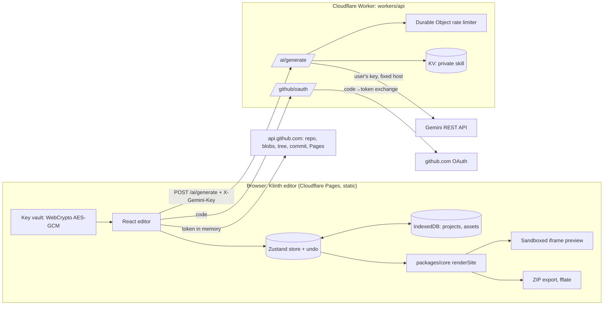
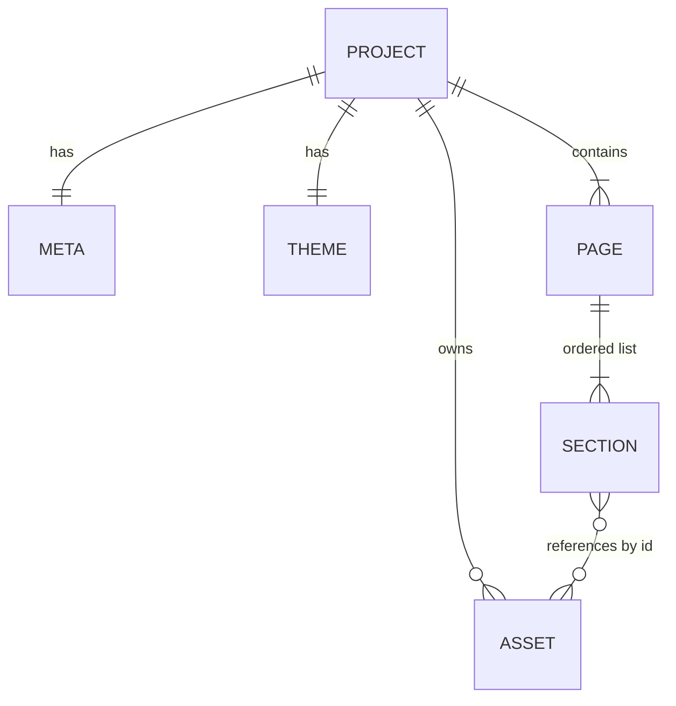

# Klinth architecture

Klinth is a free, no-login visual website builder. Users edit a template in the browser and export a
plain HTML/CSS/JS repository (ZIP or GitHub push). No badge, no tracking, no accounts. Source of truth
for requirements: `klinth-prompt.md`. This doc records the design and why.

## Constraints and non-goals

- **Cost:** ₹0 running cost (optional domain only). Only free tiers that stop at the limit.
- **Team:** one owner, beginner at deploying, small laptop. Everything must be operable by one person.
- **Data location:** user projects never leave the user's browser except when they export or push to
  their own GitHub. No personal data stored server-side.
- **Not building in v1:** accounts, database, CMS, e-commerce, hosted forms, paid plans, analytics,
  job queue, server-side rendering, collaboration.

## System shape

- **Modular monolith, client-heavy by necessity.** The product _is_ an interactive editor; all
  state lives in the browser. The only server code is one Worker with two routes, because two things
  cannot be done safely in the browser: hiding the private design skill, and holding the GitHub OAuth
  client secret.
- **One renderer.** `packages/core` exposes `renderSite(project) → { path, content }[]`. Preview and
  export call the same function, so what users see is what they ship. Core has no DOM dependency
  (enforced: its tsconfig `lib` excludes `DOM`), so it can run in the Worker and in tests.
- **Preview bridge.** The editor calls `renderSite(project, { editable: true })`, which only adds
  `data-k-section` / `data-k-field` attributes (tested: removing them gives the export byte for
  byte). `apps/editor/src/preview/document.ts` inlines the CSS and JS into one `srcdoc` and adds a
  small bridge script. The frame is `sandbox="allow-scripts"` (opaque origin). It posts `select`,
  `edit` and `scroll` messages to the editor origin only; the editor accepts them only from that
  frame's window and validates them with Zod. Text is read with `innerText` and never written as HTML.
- **Editor state.** One Zustand store (`apps/editor/src/state/store.ts`). Every edit goes through
  `change()`, which validates the whole project with the schema and refuses invalid results, so
  nothing broken is saved. Undo history keeps 100 steps; quick edits with the same key within 1 s
  merge into one step. Autosave runs 700 ms after the last change, one save at a time, and tells
  other tabs through `BroadcastChannel`.

## Repo layout

| Path                 | Purpose                                                       |
| -------------------- | ------------------------------------------------------------- |
| `apps/editor`        | Vite + React + TS + Tailwind + Motion editor (static SPA)     |
| `packages/core`      | Zod schema, tokens, renderer, exporter. Pure TS, no DOM       |
| `packages/templates` | The 2 templates and block definitions (data + render funcs)   |
| `workers/api`        | Cloudflare Worker: `/ai/generate`, `/github/oauth`, `/health` |
| `docs`               | This file                                                     |

npm workspaces; packages are consumed as TypeScript source (no build step between packages).

## Data model

There is no database. The only persisted entity is the **Project**, stored in IndexedDB and in
`.klinth/project.json` inside every export.

- **Aggregate root:** `Project`. Fields: `schemaVersion, meta, theme, pages[], assets[]` (see prompt 3.2).
- **IDs:** random UUIDs (`crypto.randomUUID()`) for sections and assets; slugs only for page paths.
- **Versioning:** `schemaVersion` integer plus an ordered list of pure migration functions in core;
  every import runs migrations then Zod validation. Unknown future versions are rejected with a plain
  message.
- **Asset blobs** live in a separate IndexedDB store keyed by asset id; the project JSON holds metadata only.
- **Invariant (tested):** the project file never contains an API key or token.
- **Export / deletion:** the user owns all data. "Export project file" and "Delete project" cover
  data portability and erasure. Nothing to purge server-side.

## Tenancy, auth and permissions

Single user per browser, no accounts, no roles. The Worker is stateless and anonymous; it is
protected by a CORS allow-list, input validation, size caps and per-IP rate limits, not by identity.
GitHub access uses the user's own OAuth token (default scope `public_repo`), held in memory only.

## API (Worker)

| Route           | Method | Purpose                                                         | Phase |
| --------------- | ------ | --------------------------------------------------------------- | ----- |
| `/health`       | GET    | Liveness check                                                  | 0     |
| `/ai/generate`  | POST   | Instruction + section JSON → validated section JSON             | 5     |
| `/github/oauth` | POST   | Exchange OAuth `code` for token; returns token, never stores it | 6     |

- JSON in and out, Zod-validated on both sides. Error shape: `{ "error": "<plain message>" }`.
- Request body cap ~64 KB. `429` with `Retry-After` on rate limit. Fixed upstream hosts (no SSRF).
- Never logs keys, tokens, bodies or the skill.

## AI path

- Browser sends the user's Gemini key in `X-Gemini-Key` over HTTPS to the Worker only.
- Worker: rate limit (Durable Object token bucket, ~30/h per IP + built-in burst binding) → load skill
  from KV → call Gemini with structured-output schema, low temperature, max tokens, 60 s timeout, one
  retry on 5xx, none on 4xx/429 → Zod-validate → skill-echo guard → return section JSON only.
- Gemini down or quota hit: plain banner, manual editing keeps working. AI is optional to the product.

## Security by design

- Preview and custom code run in sandboxed iframes (`allow-scripts`, never `allow-same-origin`).
- Renderer escapes all text; URL allow-list `https:`, `mailto:`, `tel:`; embeds by URL only, parsed by
  strict patterns (`youtube-nocookie.com`, Vimeo); raw iframe HTML rejected.
- Key vault: PBKDF2-SHA-256 (≥600k iterations, random salt) → AES-GCM; only ciphertext, salt, IV in
  localStorage; passphrase never stored. Honest UI copy about its limits.
- Editor CSP and security headers via Cloudflare Pages `_headers` (Phase 7). No `eval`, no
  `innerHTML` with user data (ESLint `no-eval`, `no-implied-eval`). `npm audit` in CI.

## Failure modes

| Dependency | If down or slow                                        | If it returns garbage            |
| ---------- | ------------------------------------------------------ | -------------------------------- |
| Gemini     | 60 s timeout, one 5xx retry, banner; manual edit works | Zod rejects, plain error         |
| Worker     | AI and GitHub push unavailable; editing and ZIP work   | Editor validates responses       |
| GitHub API | Push fails with plain message; ZIP still works         | Each step checked; no partial ok |
| IndexedDB  | Warn, keep in memory, push user to export project file | Zod on load, refuse bad data     |

## Environments and configuration

- **Local:** Vite dev server (`:5173`) + `wrangler dev` local mode (`:8787`).
- **Production:** Cloudflare Pages (editor) + Cloudflare Worker (api). No staging at launch; Pages
  preview deployments act as staging for the editor.
- Config via env vars (names in `.env.example`). Secrets via `wrangler secret put`. Skill via
  `wrangler kv key put`. Nothing secret in git.

## Operations

- Availability goal: "best effort on free tiers". The editor works offline once loaded except AI and push.
- Rollback: Cloudflare Pages and Workers both keep previous deployments; roll back from the dashboard
  or `wrangler rollback`.
- Logs: Workers observability with no secrets or bodies (Phase 7).

## Cost

| Item                          | Launch                        | 100 users | 1,000 users |
| ----------------------------- | ----------------------------- | --------- | ----------- |
| Pages, Workers, KV, DO (free) | ₹0                            | ₹0        | ₹0          |
| Gemini                        | ₹0 (user's own key and quota) |           |             |
| GitHub                        | ₹0 (user's own account)       |           |             |
| Domain (optional)             | ~₹800–1,200/yr                |           |             |

Free tiers hard-stop at the limit, so growth degrades service (AI 429s) rather than creating a bill.
Exact limits are verified and recorded in `handoff.md` before the phase that depends on them.

## Decision records

**DR-1 Static SPA, no backend app.** Options: SPA + Worker; Next.js on Pages; Spring Boot + Postgres.
Chose SPA + Worker: ₹0, no accounts needed, simplest to run. Change if accounts or sync are added.

**DR-2 Browser storage (IndexedDB) instead of a database.** Options: IndexedDB; D1; Postgres.
No accounts means no server identity to attach data to; IndexedDB keeps data private and free. Risk:
browser data loss, mitigated by project-file export nudges. Change if cross-device sync is wanted.

**DR-3 Cloudflare Workers for the two server needs.** Options: Workers; Vercel/Netlify functions;
none. Workers free plan stops at limits, has KV and Durable Objects for the skill and rate limits.
Change if Cloudflare free terms change materially.

**DR-4 Durable Object token bucket for rate limits.** Options: DO; KV counters; built-in binding only.
KV is eventually consistent (bad for counters); the built-in binding is per-location and short-window.
DO gives an exact per-IP hourly bucket; the built-in binding stays as a burst guard.

**DR-5 Exported site is plain HTML/CSS/JS.** Options: plain; Astro/Next export. Plain hosts anywhere
with no build step, which non-coders need. Change only if a feature truly needs a framework.

**DR-6 npm workspaces, packages as TS source.** Options: npm; pnpm; Turborepo. npm is already installed
and enough for 4 packages; no build step between packages keeps dev light. Change if install times
hurt or the repo grows past ~10 packages.

**DR-7 GitHub via OAuth app + browser Git Data API.** Options: OAuth app; GitHub App; ZIP only.
Worker only exchanges the code (needs the client secret); token stays in browser memory. A GitHub App
gives finer permissions but is more setup for the owner; revisit if users want per-repo access.

## Build order

0. Scaffold, CI, docs (this phase). 1. Core engine (schema, renderer, export, persistence). 2. Blocks
   and 2 templates. 3. Editor UI. 4. Media, embeds, custom code. 5. AI Worker, key vault, AI panel.
1. GitHub push. 7. Hardening. 8. Deploy and launch.

Riskiest piece is the renderer/exporter contract (everything depends on it), so it comes first.
Deferred: accounts, sync, hosted forms, analytics, more templates, Turnstile (until abuse appears).

## Honest limits

- The key vault protects against casual access, not against malicious scripts while unlocked.
- Hiding the skill server-side stops direct reading, but style rules may be inferred from outputs.
- Exported sites with custom code ship without a CSP.
